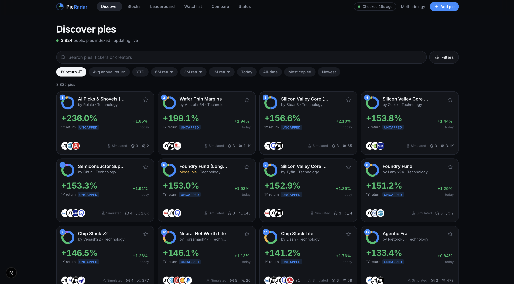
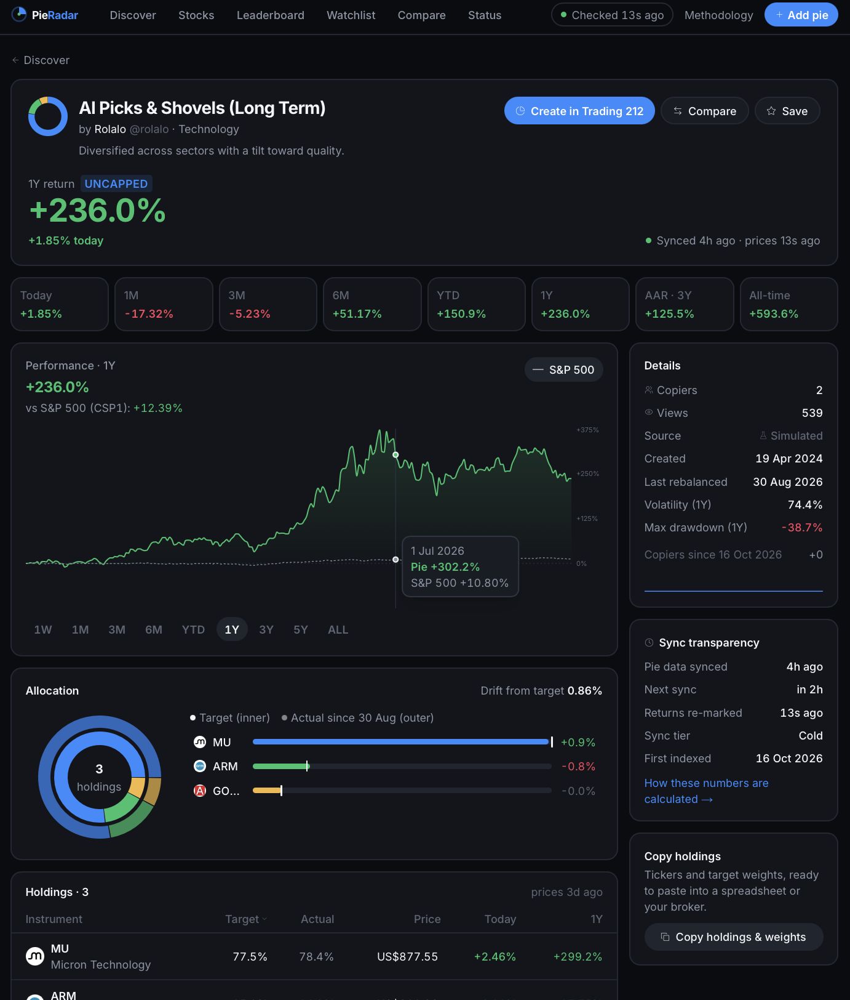
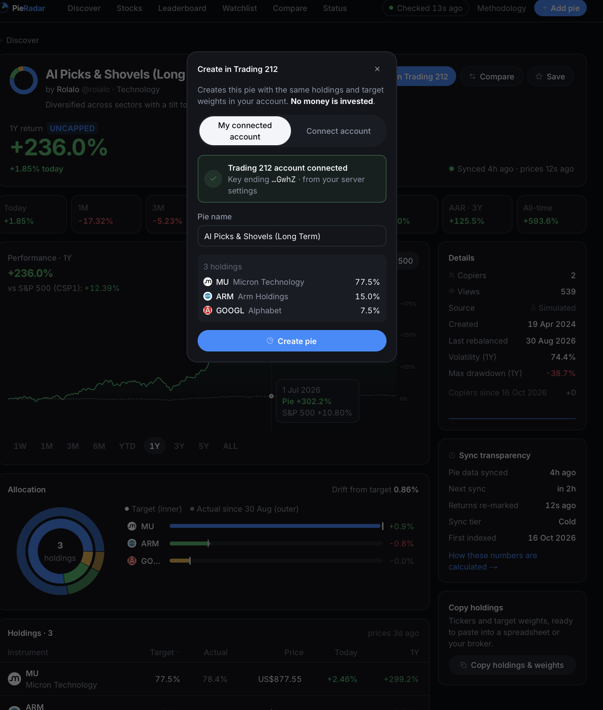
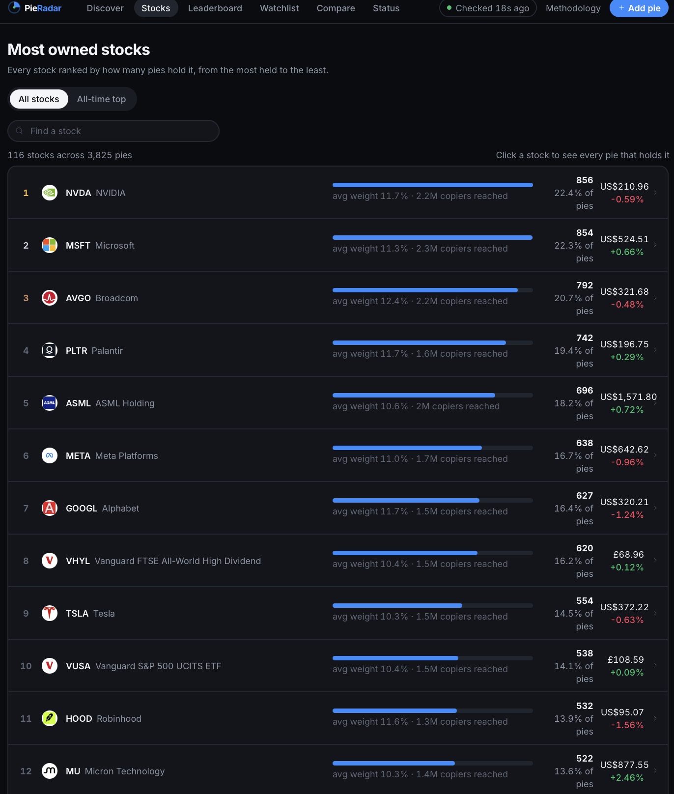
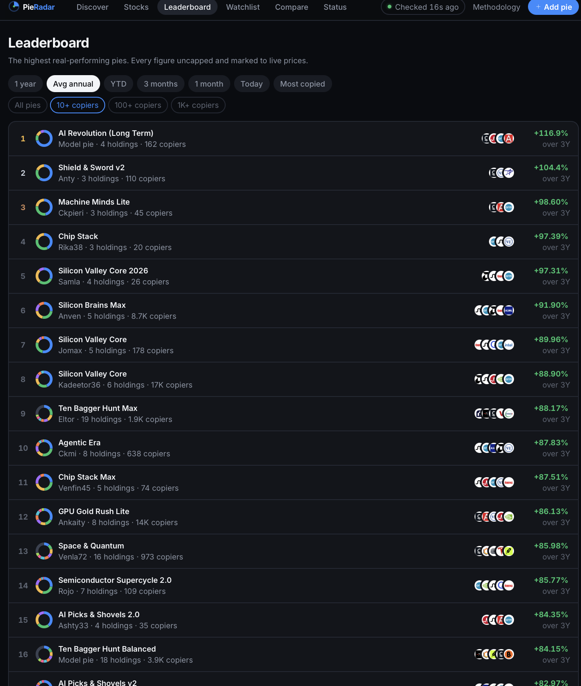
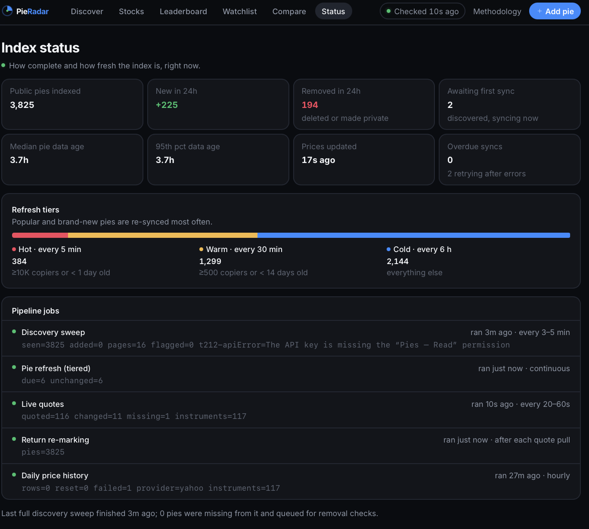

# PieRadar

**Live performance of stock pies.** Browse, rank and compare weighted baskets of stocks and ETFs, with returns calculated from real market prices and never capped. Copy any pie into your own Trading 212 account in one click.



## Features

- **Discover**: thousands of pies in a virtualised grid. Search by pie, ticker, company or creator, sort 10 ways (1Y, AAR, YTD, 6M, 3M, 1M, today, all-time, most copied, newest) and filter by category, holdings, return range and copiers.
- **Uncapped returns**: 1D, 1M, 3M, 6M, YTD, 1Y, average annual return and all-time, plus volatility and max drawdown, all computed from live prices.
- **Pie pages**: performance chart vs the S&P 500 (1W to all-time), target vs actual allocation drift, full holdings table with live prices, similar pies by holdings overlap.
- **Create in Trading 212**: connect your Trading 212 API key once, then recreate any pie in your account with one click via the official API. Nothing is invested.
- **Most owned stocks**: every ticker ranked by how many pies hold it, plus an all-time top 20 / 30 / 40 / 50 / 75 / 100 / custom view.
- **Leaderboard, watchlist and compare** (up to 4 pies side by side, with overlaid charts and holdings overlap).
- **Live**: prices refresh every 20–60s, on-screen numbers update every 15s and immediately when you return to the tab. A status page shows how fresh everything is.

| Pie page | Create in Trading 212 |
| --- | --- |
|  |  |

| Most owned stocks | Leaderboard |
| --- | --- |
|  |  |



> **About the data.** Stock prices and every return figure are real (Yahoo Finance, or Polygon). The pies listed out of the box are **simulated**: names, creators, holdings and copier counts are generated so the app has something to show, and each one is labelled "Simulated". Trading 212 offers no way to list other users' pies, so real pies come in through the official API or community submissions (see below).

## Tech

Next.js 15 (App Router) · TypeScript · Tailwind CSS v4 · Framer Motion · TanStack Query + Virtual · Recharts · Drizzle ORM on Postgres (PGlite locally) · Inngest / Vercel Cron · Upstash Redis · Yahoo Finance / Polygon

## Quick start

```bash
npm install
npm run dev     # development, http://localhost:3000
npm run fast    # optimised build: ~10× faster page loads
```

No accounts or settings are needed:

- **Database:** embedded Postgres (PGlite) in `./.data`, created and migrated automatically.
- **Pies:** a simulated, time-evolving universe of ~3,800 pies (new pies appear, some get deleted, copiers drift, pies rebalance), so every part of the pipeline runs.
- **Prices:** simulated by default. Set `MARKET_PROVIDER=yahoo` in `.env.local` for real live prices.
- **Background jobs:** run in-process alongside the server.

Settings go in `.env.local`; every option is documented in [`.env.example`](.env.example).

### Create in Trading 212

1. Trading 212 → Settings → API → generate a key with **Metadata** and **Pies – Write** (add **Pies – Read** to also sync your own public pies).
2. Open any pie → **Create in Trading 212** → **Connect account**, then paste the key and secret. They're checked with Trading 212 (nothing is created) and stored encrypted in an HttpOnly cookie.
3. Click **Create pie**. Duplicate names become "Name (2)", "Name (3)", and so on.

Or run `npm run t212:setup` to save a key to `.env.local` from your clipboard, with the same checks.

## How it works

```
discover (3–5 min) ─► new pies ─► refresh ─► holdings · snapshot · metrics
     └─ pie missing from a full sweep ─► verify ─► removed after 2 consecutive not-founds
scheduler (1 min) ─► due pies by tier: hot 5m · warm 30m · cold 6h, backoff on errors
quotes (20–60s) ─► only changed prices written ─► re-mark every pie's returns
history (hourly) ─► incremental dividend/split-adjusted daily closes
```

Returns use a buy-and-hold position at the pie's **current target weights** from the start of each window, marked to the latest price: `Σ wᵢ · Pᵢ(now) / Pᵢ(start) − 1`. Holdings without history are excluded and the rest re-weighted (coverage is shown). Returns are in each instrument's local currency, with no fees. Full details are on `/methodology` and in [`src/lib/perf.ts`](src/lib/perf.ts).

| Path | Role |
| --- | --- |
| `src/lib/sync/jobs.ts` | Pipeline jobs as plain functions |
| `src/lib/sync/local-scheduler.ts` | In-process scheduler (local / long-running Node) |
| `src/inngest/functions.ts` | Production scheduler: durable steps, fan-out, per-account throttling |
| `src/lib/perf.ts` | Return and risk engine (pure functions) |
| `src/lib/sources/*` | Pie sources (`demo`, Trading 212 API) behind one interface |
| `src/lib/market/*` | Price providers: demo, Yahoo, Polygon |
| `src/lib/broker-session.ts` | Encrypted "connected account" cookie |

## Real Trading 212 pies

Trading 212 has no endpoint that lists every public pie, and it blocks automated access to pie pages. PieRadar doesn't work around that. Real pies come in through sanctioned routes, and each one is labelled with its origin:

| Origin | How it gets in | Label |
| --- | --- | --- |
| `t212-api` | Your accounts, synced via the official API (`T212_API_KEY` / `T212_API_ACCOUNTS`) | Verified |
| `imported` | A visitor imports their own public pies with a one-time key on **Add pie** | Verified |
| `submitted` | A share link plus holdings entered on **Add pie** | Submitted |
| `demo` | Generated for development | Simulated |

To run with real pies only, set `PIE_SOURCES=t212-api` and run `npm run demo:purge` once.

## Deploying (Vercel)

1. Postgres (e.g. Neon) → `DATABASE_URL`. Migrations run during the build.
2. Upstash Redis → `UPSTASH_REDIS_REST_URL` / `UPSTASH_REDIS_REST_TOKEN`.
3. Inngest integration (`INNGEST_EVENT_KEY` / `INNGEST_SIGNING_KEY`), or `CRON_SECRET` with the crons in `vercel.json`.
4. `MARKET_PROVIDER=polygon` + `POLYGON_API_KEY`. Yahoo's endpoints are unofficial and unlicensed for commercial use, so a public site should use a licensed feed.
5. `BROKER_SESSION_SECRET` (`openssl rand -hex 32`) and `NEXT_PUBLIC_SITE_URL`. Keep `ALLOW_OWNER_CREATE=off` on a public site.

## Tests

```bash
npm test
```

Runs against an isolated database (`.data/test`) and covers the return engine, removal logic, ticker mapping, holdings parsing, submissions, stock rankings, and the Trading 212 import and create flows against a mock of the official API.

## Disclaimer

PieRadar is an independent project, not affiliated with Trading 212. It's for information only and isn't financial advice. Past performance, especially when back-applied to current weights, doesn't predict future results.
